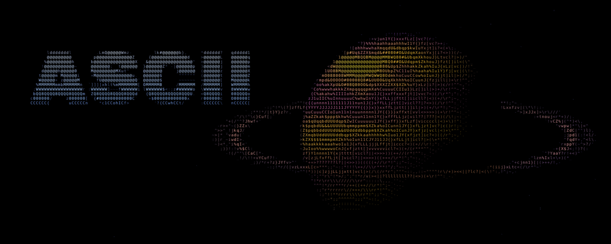
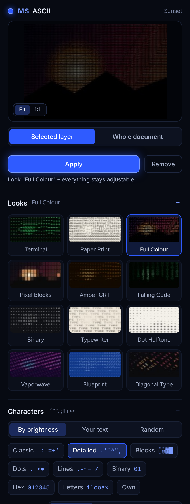
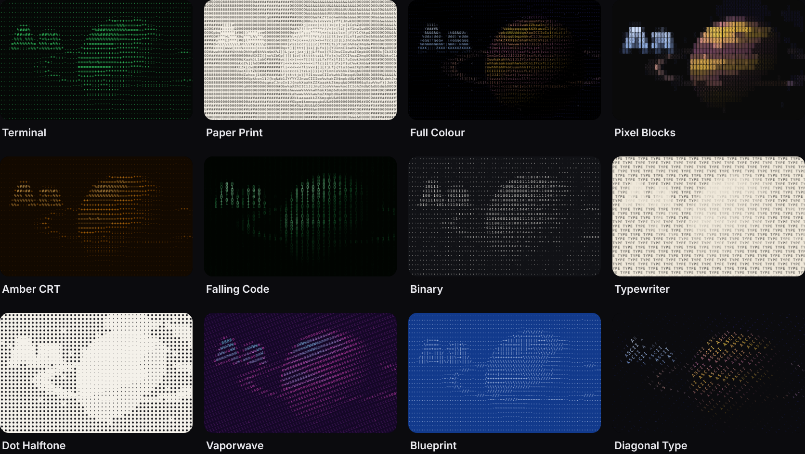
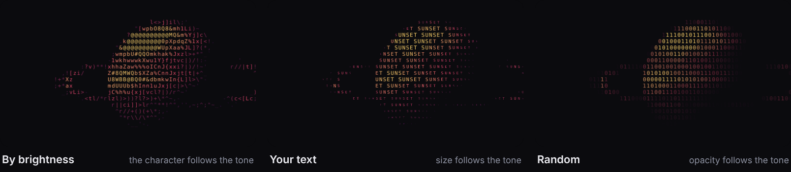
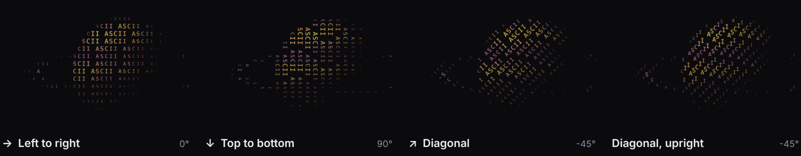

<p align="center">
  
</p>

<p align="center">
  <b>Turn a layer or the whole document into ASCII art – any font, your own characters or text, at any angle.</b><br>
  <sub>Photoshop 2023 (24.2) or newer · UXP panel</sub><br>
  <sub>More tools by <b>Linus Leinberger</b> · <a href="https://github.com/M0rgenst3rn/afterglow">Afterglow</a> · <b>Asciiwave</b> · <a href="https://github.com/M0rgenst3rn/gradient-library">Gradient Library</a> · <a href="https://github.com/M0rgenst3rn/gridwork">Gridwork</a> · <a href="https://github.com/M0rgenst3rn/grime">Grime</a> · <a href="https://github.com/M0rgenst3rn/headliner">Headliner</a> · <a href="https://github.com/M0rgenst3rn/misprint">Misprint</a> · <a href="https://github.com/M0rgenst3rn/seamline">Seamline</a> · <a href="https://github.com/M0rgenst3rn/vhold">Vhold</a></sub>
</p>

---

## What is Asciiwave?

A panel for Photoshop that rebuilds your picture from characters. Pick the selected layer or the whole
document, pick a look, and the result lands as a normal pixel layer above the original. The settings stay
in that layer: select it later, change anything, click **Update**.

<p align="center"></p>

### Highlights

- **Selected layer or whole document**: a layer keeps its shape – only the layer turns into characters
- **12 looks**: terminal, paper print, full colour, pixel blocks, amber CRT, falling code, binary, typewriter,
  dot halftone, vaporwave, blueprint, diagonal type
- **Characters your way**: 8 ready-made sets, your own characters, or **your own text** running through the
  picture
- **Any font**: monospaced fonts on your computer are offered first, every other installed font is one search
  away
- **Any direction**: left to right, top to bottom, diagonal or any angle – with the characters turned along
  or kept upright
- **Colour**: one ink colour, the colours of the picture, or a gradient from shadows to lights – on a
  transparent or coloured background
- **Live preview** in the panel, whole picture or 1:1 detail
- **Non-destructive**: the original stays untouched below, **Remove** brings it back

## Looks

<p align="center"></p>

Every look is a starting point – all settings stay adjustable, and your own presets are saved in the panel.

## Characters

<p align="center"></p>

| Mode | What happens |
|---|---|
| **By brightness** | The tone picks the character: light areas get light characters, dense areas dense ones |
| **Your text** | Your word or sentence runs through the grid line by line; the tone sets the **size** or **opacity** |
| **Random** | Random characters from the set (e.g. 0 and 1); the tone sets size or opacity |

- **Sets**: Classic, Detailed (70 characters), Blocks, Dots, Lines, Binary, Hex, Letters – or **Own**
- **Order the characters by their ink**: the panel measures every character in the chosen font and sorts them
  from light to dense. Turn it off to keep your own order
- **Dense on**: dark areas (for light backgrounds) or light areas (for dark backgrounds)

## Font

The panel lists the monospaced fonts it finds on your computer (Courier New, Menlo, Consolas, JetBrains Mono,
IBM Plex Mono, Space Mono and many more). **All fonts** searches every font installed for Photoshop – a
proportional font works too, every character is centred in its cell.

How it works: the characters are drawn once with real Photoshop text layers inside a step that is undone right
away, so your document stays as it was. After that the font is ready for the session.

## Grid & direction

<p align="center"></p>

- **Cell size**: height of a character cell in pixels
- **Cell width**: in % of the height – 60 % suits most monospaced fonts, 100 % gives square cells
- **Character size**: makes the characters bigger or smaller than the cell
- **Direction**: eight one-click directions, or any **angle**. **Keep the characters upright** turns only the
  lines

## Tone & colour

- **Contrast**, **Brightness**, **Leave empty below** (cleans up backgrounds)
- **One colour**, **From image** (with saturation) or **Gradient** with 8 palettes or your own three colours
- **Background**: transparent or a colour. With a layer, the background follows the layer's shape

## Installation

### macOS (recommended)

Open Terminal, paste this and press Enter. It downloads the plugin to your Downloads folder,
unzips it and installs it:

```bash
cd ~/Downloads && curl -fL -o asciiwave.zip https://github.com/M0rgenst3rn/asciiwave/archive/refs/heads/main.zip && unzip -oq asciiwave.zip && cd asciiwave-main && bash install-mac.sh
```

Then start Photoshop → **Plugins › Asciiwave**

Prefer to do it by hand? Click **Code → Download ZIP**, unzip it, open Terminal in the unzipped folder and run
`bash install-mac.sh`.

### Alternative: UXP Developer Tool (macOS & Windows)

1. Install "UXP Developer Tools" from the Creative Cloud app
2. In Photoshop, turn on **Developer Mode** under *Settings › Plugins*
3. In the UXP Developer Tool choose **Add Plugin**, then `ascii/manifest.json` → **Load**

## How to use it

1. Open a document and the panel (**Plugins › Asciiwave**)
2. Choose **Selected layer** (and select a layer) or **Whole document**
3. Click a look, then fine-tune characters, font, grid and colour. The preview follows every change –
   **1:1** shows the real size
4. Click **Apply**. A layer "Asciiwave · …" appears above the original (one undo step)
5. **Change it later**: select the ASCII layer, adjust, click **Update**
6. **Remove** deletes the ASCII layer and shows the original again

**Tip:** for crisp results at print size, set the cell size in relation to the document: a 4000 px wide
poster with 12 px cells has over 500 characters per line.

## Project structure

```
ascii/               The plugin (loaded into Photoshop as is)
  manifest.json      Plugin description
  index.html         Panel UI
  ui.js/.css      Shared controls and design
  styles.css         Panel-specific styles
  main.js            Photoshop side (glyphs from text layers, layers, XMP, preview, self-test)
  core.js            The engine: grid, characters, colours – plain JavaScript without Photoshop
  icons/             Panel and plugin icons
install-mac.sh       Packs the plugin (.ccx) and installs it
tools/               Checks, README images, icons, browser preview of the panel
docs/images/         Images of this README
```

```bash
node tools/check.js       # engine checks without Photoshop
node tools/make-icons.js  # ascii/icons
```

The panel and the README images in a browser: run `python3 -m http.server` in the repository and open
`http://localhost:8000/tools/ui-preview.html` (the panel, Photoshop mocked) or
`http://localhost:8000/tools/readme-images.html` (the images, drawn with the real engine).

In the panel, **Self-test** (in *Presets & tools*) creates a test document and checks every function against
the real Photoshop result. Close the test document afterwards without saving.

## Found a bug? Got an idea?

Get in touch! The easiest way is **[Issues](https://github.com/M0rgenst3rn/asciiwave/issues)** here on GitHub:
click **New issue** and briefly describe what happened. Your Photoshop version, operating system and a
screenshot help a lot. All you need is a free GitHub account. Suggestions and feature requests are just as
welcome.

## License

[MIT with the Commons Clause](LICENSE): the plugin is free. You may use it for any work, including paid
client work, and you may read, change and share the code.
You may not sell the plugin or a version of it (changed or not), or charge for a product or service whose
value comes mainly from it.
Everything you create with it (designs, images, prints) is yours, and you may sell it.
The license notice stays in copies.

Adobe and Photoshop are trademarks of Adobe Inc. This project is independent and not affiliated with Adobe.

---

<p align="center"><sub>Asciiwave<br>
Made by Linus Leinberger · <a href="https://www.instagram.com/linusleinberger">Instagram @linusleinberger</a></sub></p>
